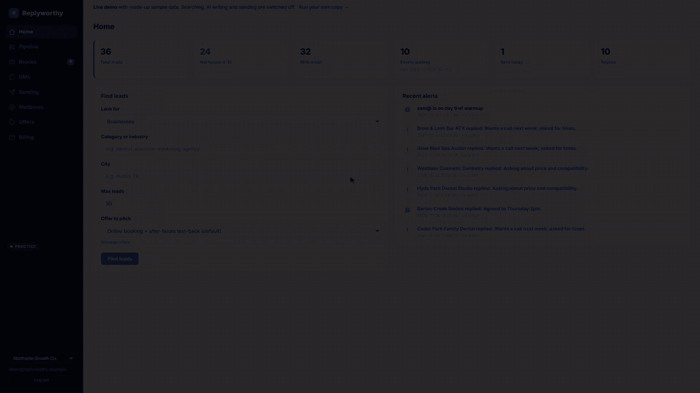
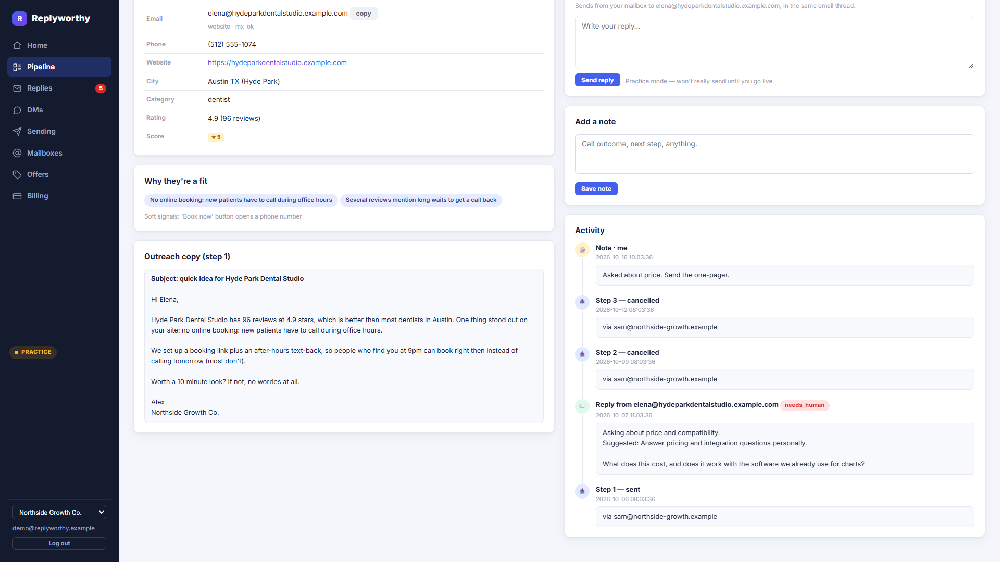
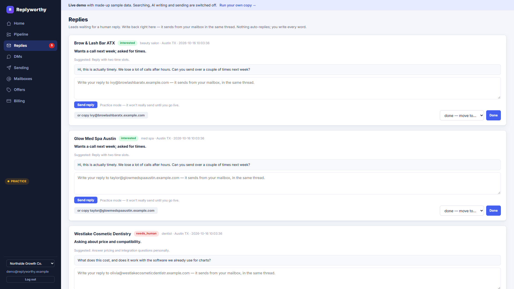
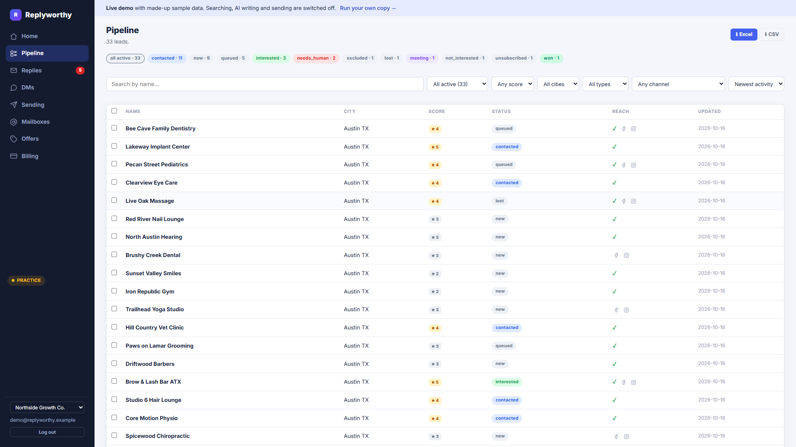
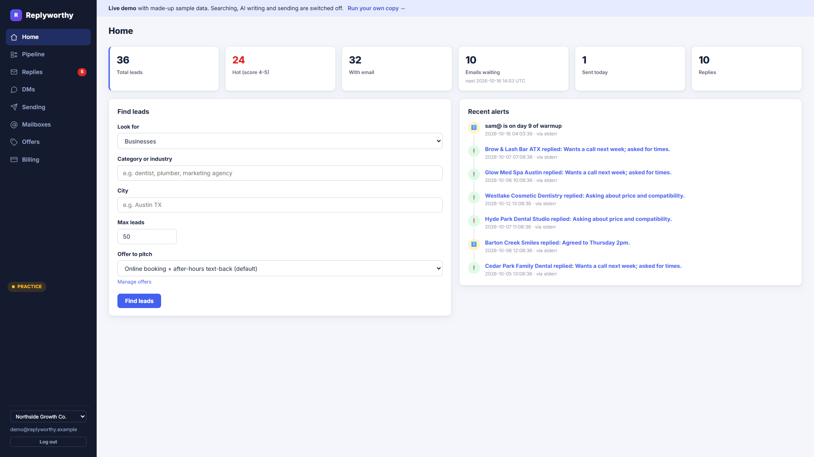
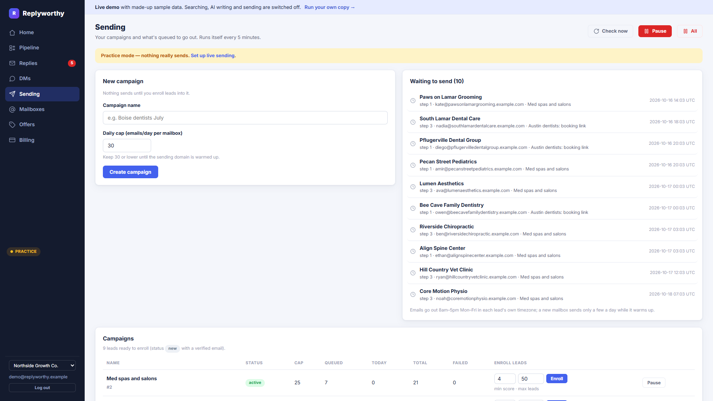
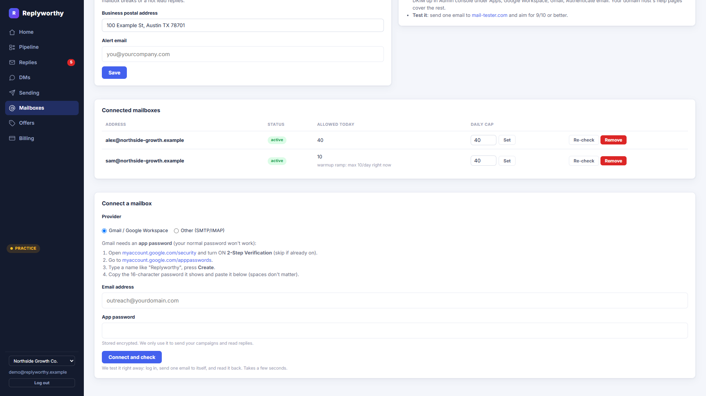
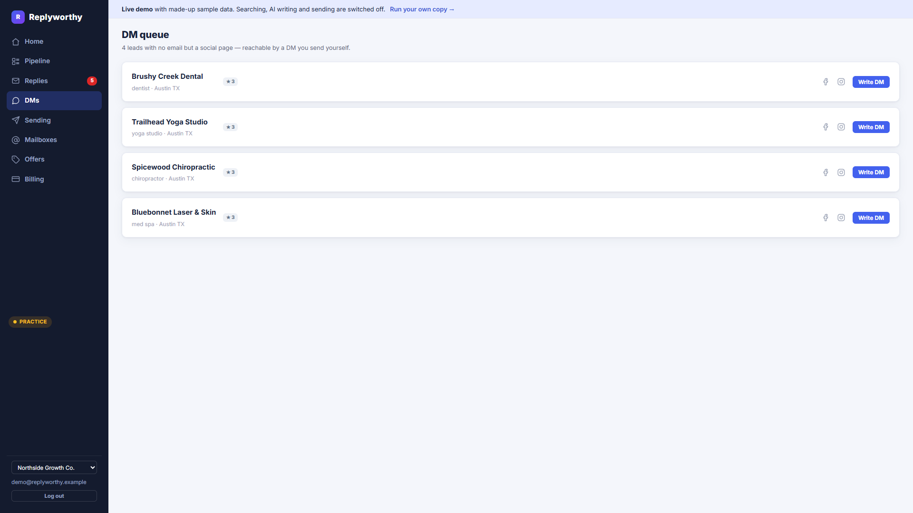
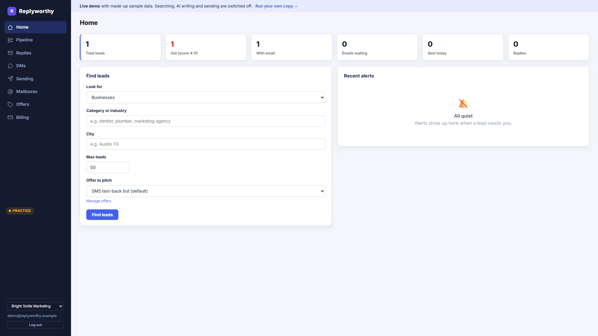
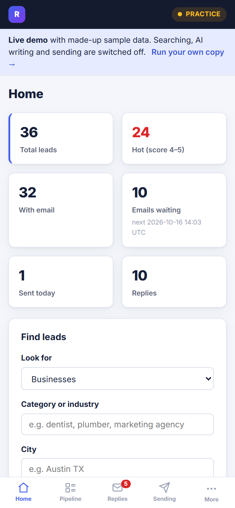

# Replyworthy

**An open-source AI outreach agent for local businesses. It finds the leads, writes a personal first email, sends a careful sequence, and sorts the replies so you only read the ones that matter.**

You run it yourself, with your own API keys, your own mailboxes and your own database. Nothing phones home.

[](LICENSE)


**[▶ Try the live demo](https://replyworthy-demo.onrender.com)** · [Watch the 50-second walkthrough](docs/media/walkthrough.mp4) · [Run your own](#quickstart)

<a href="docs/media/walkthrough.mp4"></a>

> The live demo is filled with made-up sample data. Searching, AI writing and sending are switched off there, so click around freely. It runs on a free server, so the first visit can take about 30 seconds to wake up.

---

## What it does

**1. Finds leads.** Give it a category and a city ("dentist", "Austin TX"). It pulls businesses from Google Maps, drops chains, and skips anyone whose site already has a booking system, so you don't pitch people who are already sorted.

**2. Scores each one and writes the first email.** Claude reads the business's own website and reviews, scores the fit from 1 to 5 with the reasons why, and writes a short first email that mentions something real about them.



**3. Sends a 3-step sequence, safely.** It sends from your own mailboxes, ramps up new mailboxes slowly (warmup), caps how many go out each day, and pauses your sending by itself if too many emails bounce. It stays in practice mode until you turn sending on.

**4. Sorts the replies.** Every reply gets a label: interested, not interested, unsubscribe, out of office, wrong person, or needs you. The sequence stops on any reply. **It never answers a prospect on its own.** Hot replies land in one inbox for you to answer.



**5. Keeps the whole pipeline in one place.** Filter by stage, score, city or channel, export to Excel, and leave notes. Leads with no public email go to a DM queue with their Instagram and Facebook links.



<details>
<summary><b>More screenshots</b> (dashboard, sending, mailboxes, DMs, admin view, mobile)</summary>

| | |
|---|---|
|  |  |
|  |  |
|  |  |

</details>

---

## Quickstart

You need Python 3.10 or newer. No API keys are needed to look around.

**macOS / Linux**

```bash
git clone https://github.com/syedzeeshan-27/replyworthy-public.git
cd replyworthy-public
python3 -m venv .venv && source .venv/bin/activate
pip install -e .
cp .env.example .env
python tools/seed_demo.py        # optional: load the sample data
uvicorn web.app:app --reload
```

**Windows (PowerShell)**

```powershell
git clone https://github.com/syedzeeshan-27/replyworthy-public.git
cd replyworthy-public
python -m venv .venv; .venv\Scripts\Activate.ps1
pip install -e .
Copy-Item .env.example .env
python tools/seed_demo.py        # optional: load the sample data
uvicorn web.app:app --reload
```

Open <http://localhost:8000>. With the Supabase keys left blank, the app runs in **local single-user mode**: no signup, you're signed straight in as the owner. Done with the sample data? Stop the app and delete `data/leads.db` for a clean slate (or run `python tools/seed_demo.py --reset` to reload the samples).

### Add your own keys

Fill in `.env` as you need each feature. Everything is optional except where noted.

| Key | What it unlocks | Cost |
|---|---|---|
| `ANTHROPIC_API_KEY` | Scoring, email writing, reply sorting, DM drafts. **Needed for real searches.** | Pay per use ([console.anthropic.com](https://console.anthropic.com)) |
| `APIFY_API_TOKEN` | The Google Maps search. **Needed for real searches.** | Free monthly credit, then pay per use ([apify.com](https://apify.com)) |
| `FIRECRAWL_API_KEY` | Backup website reader when a site blocks the normal one | Free tier |
| `B2B_DATA_API_KEY`, `B2B_DATA_API_URL` | Searching for people (job titles at companies) instead of businesses | Paid contact-data vendor |
| `SENDER_NAME`, `SENDER_PHONE`, `SENDER_ADDRESS` | Your email signature and the postal address the law asks for | Free |
| `MAILBOX_ENC_KEY` | Connecting sending mailboxes (logins are stored encrypted). Make one with `python tools/mailboxes.py --genkey` | Free |
| `DRY_RUN` | Leave `true` until your mailboxes are warmed up. `false` lets email really send | Free |
| `SUPABASE_URL`, `SUPABASE_ANON_KEY` | Real logins, so several people can use one install | Free tier ([supabase.com](https://supabase.com)) |
| `DATABASE_URL` | Postgres instead of the local SQLite file | Free tier (Supabase) |
| `TELEGRAM_BOT_TOKEN`, `TELEGRAM_CHAT_ID`, `ALERT_EMAIL` | Alerts on your phone when a hot reply comes in | Free |

Then run a search from the dashboard, or from the command line:

```bash
python run_lead_gen.py --category "dentist" --city "Austin TX" --limit 50
```

Each run also writes an Excel file to `outputs/`.

---

## Deploy your own

The app ships with a `Dockerfile` and a Render blueprint (`render.yaml`).

[](https://render.com/deploy?repo=https://github.com/syedzeeshan-27/replyworthy-public)

1. Make a free Supabase project. Run `supabase/01_schema.sql` in its SQL editor, and copy the project URL, the anon key and the "Session pooler" connection string.
2. Click the button above (or create a Blueprint in Render), and fill in the keys it asks for. `BASE_URL` is the address Render gives you.
3. Open the site and sign up. **The first account to log in becomes the owner (admin).** To lock that to one address, set `OWNER_EMAIL` before you share the link.

Everyone who signs up after that gets their own private workspace. The owner gets a workspace switcher in the sidebar to see any workspace's leads, campaigns and replies, plus an admin billing page.

**Want a public demo like the one above?** Create a Blueprint from `render.demo.yaml`. It runs on Render's free plan, needs no keys, loads the sample data on every start, and has every paid or outgoing action switched off.

---

## Your data stays yours

- The database is yours: a local SQLite file, or your own Postgres.
- API calls go straight from your server to Anthropic, Apify and the rest, on your keys.
- Mailbox passwords are encrypted at rest and only decrypted at the moment of sending.
- Unsubscribes are honoured across every workspace on the install, forever.
- There's no telemetry and no call home.

---

## How it's built

| Part | Choice |
|---|---|
| Web app | FastAPI + Jinja templates, no frontend build step |
| Database | SQLite locally, Postgres (Supabase) in production; the same SQL runs on both |
| Login | Supabase Auth, or local single-user mode when it isn't set up |
| AI | Claude with structured outputs (model set by `LEADGEN_MODEL`) |
| Lead source | Google Maps through Apify; optional B2B data API for people |
| Sending | Your own SMTP/IMAP mailboxes, with warmup, daily caps and a bounce breaker |
| Deploy | Docker on Render |

```
web/            FastAPI app, auth, background jobs, templates
tools/          pipeline steps, sending, reply handling, billing, database layer
tools/sources/  where leads come from (Google Maps, B2B data API)
migrations/     numbered schema changes, SQLite + Postgres pairs
supabase/       one-shot schema for a fresh Supabase project
tests/          530+ offline tests
run_lead_gen.py command-line search
```

Run the tests (no keys, no network):

```bash
python -m unittest discover -s tests
```

---

## Honest limitations

- **Cold email is a real-world risk.** Warm up new mailboxes for 2 to 3 weeks, use a separate sending domain, and follow the anti-spam laws where your prospects live. The app helps (warmup ramp, caps, unsubscribe links, postal address), but the responsibility is yours.
- **People search needs a vendor.** The B2B data connector is generic; you may need to map the fields for the vendor you pick.
- **Billing isn't wired to a live payment account.** The credit ledger works, but the payment-provider side is untested against a real account. For your own use, you can ignore billing completely.
- **English only**, and tuned for appointment-based local businesses (clinics, salons, studios). Other niches work but may need a different offer.

---

## Contributing

Issues and pull requests are welcome. See [CONTRIBUTING.md](CONTRIBUTING.md).

## License

[MIT](LICENSE). Use it, change it, sell it.
